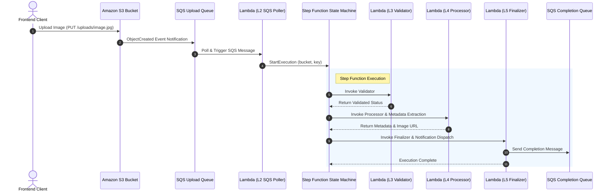
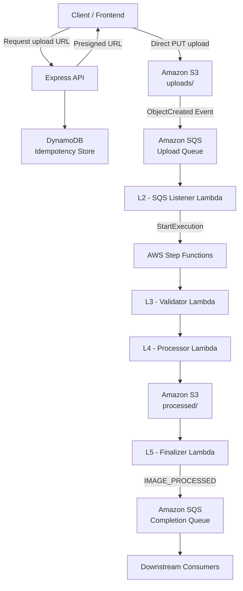

# XP Filer MG (Image & Video)
### Serverless, Event-Driven Image Processing Pipeline

XP Filer MG is a cloud-native image processing system built with **Node.js, TypeScript, and AWS serverless technologies**.

The platform provides a secure upload mechanism through presigned S3 URLs and processes uploaded images asynchronously using AWS Lambda and Step Functions.

It validates incoming images, extracts image metadata, generates optimized WebP thumbnails, stores processing artifacts in Amazon S3, and publishes completion events through Amazon SQS.

The architecture separates API responsibilities from asynchronous processing, allowing image uploads and processing workloads to scale independently.


---

## Table of Contents

1. [Overview](#overview)
2. [Architecture](#architecture)
3. [Processing Workflow](#processing-workflow)
4. [Technology Stack](#technology-stack)
5. [Project Structure](#project-structure)
6. [Getting Started](#getting-started)
7. [Environment Configuration](#environment-configuration)
8. [API Reference](#api-reference)
9. [Storage Structure](#storage-structure)
10. [Completion Events](#completion-events)
11. [AWS Infrastructure](#aws-infrastructure)
12. [Deployment](#deployment)
13. [Infrastructure Destruction](#infrastructure-destruction)
14. [Security](#security)
15. [Reliability and Limitations](#reliability-and-limitations)
16. [Testing](#testing)
17. [Monitoring and Observability](#monitoring-and-observability)

---

## 1. Overview

The system is designed around an event-driven processing model.

Instead of transferring images through the API server and processing them synchronously, clients upload images directly to Amazon S3 using presigned URLs.

S3 automatically generates an event when an image is uploaded. That event initiates an asynchronous processing workflow.

### Core capabilities

- **Direct-to-S3 uploads:** Images are uploaded directly to S3 using temporary presigned URLs.
- **Upload idempotency:** DynamoDB prevents duplicate upload records when clients retry requests.
- **Event-driven processing:** S3 notifications initiate asynchronous processing through SQS.
- **Workflow orchestration:** AWS Step Functions coordinates the processing stages.
- **Image validation:** Uploaded objects are checked for supported extensions, MIME types, and valid object size.
- **Image optimization:** Sharp generates optimized WebP thumbnails.
- **Metadata extraction:** Original image and thumbnail metadata are stored as JSON.
- **Completion notifications:** Successful processing generates a structured event in SQS.
- **Infrastructure as Code:** Terraform provisions and manages AWS infrastructure.
- **Automated deployment:** A Bash orchestrator builds, packages, validates, and deploys the infrastructure.

### Design objectives

The architecture prioritizes:

1. Separation of concerns.
2. Asynchronous processing.
3. Reduced API server workload.
4. Scalable infrastructure.
5. Controlled AWS permissions.
6. Reproducible infrastructure deployment.
7. Traceability through image identifiers and correlation IDs.

---

## 2. Architecture

The system consists of an Express API, AWS storage services, messaging infrastructure, serverless processing functions, and workflow orchestration.

### High-level architecture



### Architectural components

| Component | Responsibility |
|---|---|
| Express API | Handles upload URL requests |
| DynamoDB | Stores upload idempotency records |
| Amazon S3 | Stores original images and processing artifacts |
| Upload SQS Queue | Receives S3 upload notifications |
| L2 Lambda | Starts the processing workflow |
| AWS Step Functions | Orchestrates the processing stages |
| L3 Lambda | Validates uploaded images |
| L4 Lambda | Processes images using Sharp |
| L5 Lambda | Verifies outputs and publishes completion events |
| Completion SQS Queue | Delivers processing completion notifications |

### Architectural principle

The API does not perform image processing.

Its responsibility ends after generating a presigned URL and returning the upload information to the client.

Image processing happens independently through AWS-managed services.

---

## 3. Processing Workflow

The image processing lifecycle consists of five primary stages.

### Stage 1: Upload authorization

The client requests a presigned URL from the Express API.

The API:

- Validates the requested filename.
- Validates the requested MIME type.
- Requires an idempotency key.
- Generates a unique image identifier.
- Stores the upload request in DynamoDB.
- Generates a presigned S3 PUT URL.

The presigned URL currently expires after 60 seconds.

### Stage 2: Direct image upload

The client uploads the image directly to the S3 media bucket.

Objects are stored using the following structure:

```text
uploads/{imageId}/{filename}
```

S3 generates an `ObjectCreated` notification after a successful upload.

The notification is delivered to the upload SQS queue.

### Stage 3: Workflow initiation

The L2 SQS Listener Lambda consumes the S3 notification.

It:

- Parses the notification payload.
- Ignores S3 test events.
- Decodes the object key.
- Filters objects outside the `uploads/` prefix.
- Extracts the image identifier.
- Starts the Step Functions execution.

The image identifier is used as the Step Functions execution name.

### Stage 4: Image validation

The L3 Validator checks:

- Required pipeline event fields.
- Supported image extensions.
- S3 object existence.
- Positive object size.
- Compatibility between the file extension and declared MIME type.

Supported image formats:

| Format | Extension | MIME type |
|---|---|---|
| JPEG | `.jpg`, `.jpeg` | `image/jpeg` |
| PNG | `.png` | `image/png` |
| WebP | `.webp` | `image/webp` |

Successfully validated images continue to the processing stage.

### Stage 5: Image processing

The L4 Processor uses Sharp to process the original image.

Processing operations include:

- Downloading the original image from S3.
- Extracting image metadata.
- Applying image orientation.
- Generating a thumbnail with maximum dimensions of 400 × 400 pixels.
- Preventing unnecessary image enlargement.
- Converting the thumbnail to WebP at quality 80.
- Uploading generated artifacts to S3.

Three artifacts are generated:

| Artifact | Description |
|---|---|
| `thumbnail.webp` | Optimized WebP thumbnail |
| `metadata.json` | Original and thumbnail metadata |
| `processing-result.json` | Processing result information |

### Stage 6: Finalization

The L5 Finalizer verifies that the generated artifacts exist in the expected S3 location.

It checks:

- Expected bucket.
- Expected processed object key prefix.
- Object existence.
- Non-zero object size.
- Expected content type where returned by S3.

Once verification succeeds, it publishes an `IMAGE_PROCESSED` event to the completion SQS queue.

The final processing status is `SUCCESS`.

---

## 4. Technology Stack

| Technology | Purpose |
|---|---|
| Node.js 22 | Runtime environment |
| TypeScript | Strongly typed application development |
| Express.js 4 | HTTP API framework |
| Amazon S3 | Image and artifact storage |
| Amazon SQS | Asynchronous messaging |
| AWS Lambda | Serverless execution |
| AWS Step Functions | Workflow orchestration |
| Amazon DynamoDB | Upload idempotency storage |
| Sharp | Image processing |
| AWS SDK for JavaScript v3 | AWS service integration |
| Terraform | Infrastructure as Code |
| esbuild | Lambda bundling |
| Vitest | Automated testing |
| Helmet | HTTP security headers |
| CORS | Cross-origin request configuration |
| dotenv | Environment configuration |

---

## 5. Project Structure

```text
xp-filer-mg-v1/
│
├── src/
│   ├── controllers/
│   │   └── presignedController.ts
│   │
│   ├── handlers/
│   │   ├── l2_sqsListner.ts
│   │   ├── l3_validator.ts
│   │   ├── l4_processor.ts
│   │   └── l5_finalizer.ts
│   │
│   ├── middleware/
│   │   ├── errorHandler.ts
│   │   ├── freePort.ts
│   │   └── requestLogger.ts
│   │
│   ├── service/
│   │   └── idempotencyStore.ts
│   │
│   ├── tests/
│   │   ├── handler.test.ts
│   │   ├── middleware.test.ts
│   │   ├── presignedController.test.ts
│   │   └── server.test.ts
│   │
│   ├── types/
│   │   └── pipeline.ts
│   │
│   ├── utils/
│   │   └── logger.ts
│   │
│   ├── app.ts
│   └── server.ts
│
├── terraform/
│   ├── main.tf
│   ├── variables.tf
│   ├── output.tf
│   ├── storage.tf
│   ├── queues.tf
│   ├── lambda.tf
│   ├── iam.tf
│   ├── step_functions.tf
│   └── idempotency.tf
│
├── public/
│
├── build/
│   └── lambda/
│
├── dist/
│
├── _orchestrator.sh
├── destroy.sh
├── package.json
├── package-lock.json
├── tsconfig.json
├── .env
└── README.md
```

### Source organization

**Controllers**

Handle HTTP requests and coordinate application services.

**Handlers**

Contain the serverless processing stages executed by AWS Lambda.

**Middleware**

Provide request identification, logging, error handling, and server-related functionality.

**Services**

Contain reusable application functionality, including DynamoDB idempotency management.

**Types**

Define shared pipeline events, processing outputs, and completion message contracts.

**Utils**

Contain reusable utilities such as structured logging.

**Terraform**

Contains the infrastructure definitions, IAM policies, Lambda configuration, storage, queues, and workflow orchestration.

---

## 6. Getting Started

### Prerequisites

The following tools are required:

- Node.js 22 or later.
- npm.
- AWS CLI.
- Terraform 1.5 or later.
- An AWS account.
- Appropriate AWS IAM permissions.

### Install dependencies

Clone the repository and install dependencies:

```bash
npm install
```

### Configure AWS credentials

For local development, configure an AWS CLI profile:

```bash
aws configure
```

Verify the configured identity:

```bash
aws sts get-caller-identity
```

The identity must have the permissions required by the API and any AWS services accessed locally.

For Lambda execution, use the IAM execution roles provisioned by Terraform.

### Configure environment variables

Create a `.env` file in the project root.

See [Environment Configuration](#7-environment-configuration).

### Start the development server

```bash
npm run dev
```

The default API address is:

```text
http://localhost:3000
```

### Available npm commands

| Command | Description |
|---|---|
| `npm run dev` | Starts the development server with automatic reload |
| `npm run build` | Compiles TypeScript into `dist/` |
| `npm start` | Starts the compiled Express application |
| `npm test` | Runs the Vitest test suite |
| `npm run test:watch` | Runs tests in watch mode |

---

## 7. Environment Configuration

The application uses environment variables for runtime and AWS configuration.

Example:

```dotenv
NODE_ENV=development

PORT=3000
HOST=0.0.0.0

AWS_REGION=eu-central-1
AWS_BUCKET_NAME=

AWS_ACCESS_KEY_ID=
AWS_SECRET_ACCESS_KEY=

IDEMPOTENCY_TABLE_NAME=image-pipeline-idempotency

STATE_MACHINE_ARN=
COMPLETION_QUEUE_URL=

CORS_ORIGINS=http://localhost:3000,http://localhost:5173
```

### Variable reference

| Variable | Description |
|---|---|
| `NODE_ENV` | Application environment |
| `PORT` | Express server port |
| `HOST` | Express server bind address |
| `AWS_REGION` | AWS deployment region |
| `AWS_BUCKET_NAME` | S3 media bucket name |
| `AWS_ACCESS_KEY_ID` | AWS access key, when using explicit credentials |
| `AWS_SECRET_ACCESS_KEY` | AWS secret key, when using explicit credentials |
| `IDEMPOTENCY_TABLE_NAME` | DynamoDB idempotency table |
| `STATE_MACHINE_ARN` | Step Functions state machine ARN |
| `COMPLETION_QUEUE_URL` | Completion SQS queue URL |
| `CORS_ORIGINS` | Comma-separated list of permitted API origins |

AWS credentials should preferably be supplied through an AWS profile locally and IAM roles in AWS environments.

Never commit `.env` or AWS credentials to source control.

---

## 8. API Reference

The Express API currently exposes two endpoints.

### Health check

```http
GET /health
```

Returns the service health status.

Example:

```bash
curl http://localhost:3000/health
```

Example response:

```json
{
  "status": "healthy",
  "service": "xp-filer-mg-v1",
  "timestamp": "2026-01-01T12:00:00.000Z"
}
```

### Generate a presigned upload URL

```http
GET /api/presigned-url
```

Query parameters:

| Parameter | Required | Description |
|---|---|---|
| `filename` | Yes | Image filename |
| `type` | Yes | Image MIME type |

Required header:

```http
Idempotency-Key: unique-client-generated-key
```

The idempotency key must contain between 8 and 128 characters.

Example:

```bash
curl -G "http://localhost:3000/api/presigned-url" \
  --data-urlencode "filename=photo.jpg" \
  --data-urlencode "type=image/jpeg" \
  -H "Idempotency-Key: upload-request-123456"
```

Example response:

```json
{
  "imageId": "generated-image-uuid",
  "uploadUrl": "https://example-presigned-s3-url",
  "key": "uploads/generated-image-uuid/photo.jpg",
  "expiresIn": 60,
  "requestId": "request-id"
}
```

### Upload an image

The client uses the returned URL to upload the image directly to S3.

```bash
curl -X PUT "$UPLOAD_URL" \
  -H "Content-Type: image/jpeg" \
  --upload-file ./photo.jpg
```

The upload content type must match the content type used to generate the presigned URL.

### Idempotency behaviour

The API uses DynamoDB to manage upload request idempotency.

| Scenario | Behaviour |
|---|---|
| Same key and same request details | Reuses the existing image ID and object key |
| Same key and different request details | Returns HTTP `409 Conflict` |
| New idempotency key | Creates a new upload record |
| Expired record | Can be replaced when the request is retried |

Idempotency records have a configured expiration of 24 hours.

The idempotency mechanism currently applies to upload URL generation. It does not guarantee exactly-once execution of the entire image processing pipeline.

---

## 9. Storage Structure

The system separates original uploads from generated processing artifacts.

```text
S3 Media Bucket
│
├── uploads/
│   └── {imageId}/
│       └── original-image.jpg
│
└── processed/
    └── {imageId}/
        ├── thumbnail.webp
        ├── metadata.json
        └── processing-result.json
```

### Original uploads

Original images are stored under:

```text
uploads/{imageId}/{filename}
```

### Processed artifacts

Generated files are stored under:

```text
processed/{imageId}/
```

### Metadata

The metadata document contains information such as:

- Image identifier.
- Correlation identifier.
- Processing timestamp.
- Original content type.
- Original image size.
- Original image format.
- Original image dimensions.
- Channel information.
- Color space.
- Alpha channel information.
- Orientation.
- Thumbnail format.
- Thumbnail dimensions.
- Thumbnail size.

All S3 objects are private by default.

---

## 10. Completion Events

After successful processing, the L5 Finalizer publishes a message to:

```text
image-completion-queue
```

The event type is:

```text
IMAGE_PROCESSED
```

Example message:

```json
{
  "eventId": "image-id:IMAGE_PROCESSED",
  "event": "IMAGE_PROCESSED",
  "imageId": "image-id",
  "bucket": "image-data-processor",
  "key": "uploads/image-id/photo.jpg",
  "status": "SUCCESS",
  "processedAt": "2026-01-01T12:00:00.000Z",
  "correlationId": "image-id",
  "outputs": {
    "thumbnail": {
      "bucket": "image-data-processor",
      "key": "processed/image-id/thumbnail.webp",
      "contentType": "image/webp"
    },
    "metadata": {
      "bucket": "image-data-processor",
      "key": "processed/image-id/metadata.json",
      "contentType": "application/json"
    },
    "result": {
      "bucket": "image-data-processor",
      "key": "processed/image-id/processing-result.json",
      "contentType": "application/json"
    }
  }
}
```

The example contains illustrative values.

Downstream services can consume completion events to initiate additional workflows, update application records, or notify users.

Consumers should use `eventId` to implement their own duplicate-event handling.

---

## 11. AWS Infrastructure

Terraform manages the AWS resources required by the processing pipeline.

### Infrastructure inventory

| AWS resource | Purpose |
|---|---|
| S3 media bucket | Original images and processed artifacts |
| S3 log bucket | Server access logging |
| SQS upload queue | Receives S3 object notifications |
| SQS completion queue | Delivers successful processing events |
| Lambda L2 | SQS event listener |
| Lambda L3 | Image validator |
| Lambda L4 | Image processor |
| Lambda L5 | Processing finalizer |
| Step Functions | Processing workflow |
| DynamoDB | Upload idempotency |
| IAM roles | Lambda and Step Functions permissions |
| AWS Budget | Monthly spending notifications |

### Lambda configuration

All Lambda functions use the Node.js 22 runtime.

| Function | Memory | Timeout | Responsibility |
|---|---:|---:|---|
| L2 SQS Listener | 256 MB | 60 seconds | Starts Step Functions |
| L3 Validator | 256 MB | 30 seconds | Validates uploaded objects |
| L4 Processor | 512 MB | 60 seconds | Generates image artifacts |
| L5 Finalizer | 256 MB | 30 seconds | Verifies outputs and publishes completion events |

The L4 Lambda uses the x86_64 architecture because its deployment package includes the corresponding native Sharp dependency.

### SQS configuration

The upload queue currently uses:

- Standard SQS queue.
- Visibility timeout of 360 seconds.
- Lambda event source mapping.
- Batch size of one.

The completion queue is also a standard SQS queue.

### DynamoDB configuration

The idempotency table uses:

- Partition key: `idempotencyKey`.
- Billing mode: `PAY_PER_REQUEST`.
- TTL attribute: `expiresAt`.
- Server-side encryption.

### AWS budget

Terraform provisions a monthly AWS budget.

Default configuration:

- Monthly limit: USD 20.
- Actual-spend notification: 80%.
- Forecasted-spend notification: 80%.

The budget sends notifications; it does not automatically stop AWS resources or prevent additional spending.

---

## 12. Deployment

Infrastructure deployment is coordinated through:

```text
_orchestrator.sh
```

### Deployment prerequisites

Before deployment:

1. Configure AWS credentials.
2. Create and configure the `.env` file.
3. Ensure `AWS_BUCKET_NAME` is configured.
4. Ensure the deployment identity has sufficient AWS permissions.
5. Install Node.js, npm, and Terraform.

### Run deployment

From the repository root:

```bash
chmod +x _orchestrator.sh
./_orchestrator.sh
```

### Deployment process

The orchestrator performs the following operations:

1. Loads environment configuration.
2. Builds the TypeScript application.
3. Bundles the Lambda handlers using esbuild.
4. Packages Sharp for Linux x86_64.
5. Runs a Sharp smoke test.
6. Initializes Terraform.
7. Formats and validates Terraform configuration.
8. Generates a Terraform execution plan.
9. Requests approval before applying infrastructure changes.
10. Applies the approved plan.
11. Displays Terraform outputs.

### Important deployment distinction

The orchestrator deploys the Lambda functions and provisions AWS infrastructure.

It does **not** deploy the Express API server.

The Express API must be hosted and operated separately.

---

## 13. Infrastructure Destruction

Infrastructure destruction is handled separately through:

```text
destroy.sh
```

The destruction script is designed to remove Terraform-managed AWS infrastructure without requiring a complete application build.

### Run destruction

```bash
chmod +x destroy.sh
./destroy.sh
```

The script:

1. Loads environment configuration.
2. Validates the required bucket configuration.
3. Requests explicit confirmation.
4. Creates temporary placeholder Lambda source files when the build artifacts are missing.
5. Runs `terraform destroy`.
6. Removes temporary files.

The placeholders exist only to allow Terraform's `archive_file` data sources to be evaluated during destruction.

They are not application code and must never be used for deployment.

### Deployment versus destruction

| Operation | Script | Purpose |
|---|---|---|
| Deploy | `_orchestrator.sh` | Builds real Lambda packages and provisions infrastructure |
| Destroy | `destroy.sh` | Removes Terraform-managed infrastructure |

Keep these scripts separate.

### Data deletion warning

The media and logging S3 buckets use Terraform's `force_destroy = true` configuration.

Destroying the infrastructure can permanently delete:

- Original uploaded images.
- Processed images.
- Metadata and processing results.
- S3 access logs.

Back up required data before confirming destruction.

Terraform state and source code should be retained so that the infrastructure can be recreated later.

---

## 14. Security

The infrastructure and API include several security controls.

### S3 security

- Public access is blocked.
- Bucket policies deny non-TLS requests.
- Original and processed images remain private.
- S3 access logging is configured.
- Upload URLs are time-limited.

### API security

The Express application uses:

- Helmet security headers.
- Configurable CORS origins.
- Request identification.
- Structured request logging.
- A centralized error handler.
- Disabled Express `X-Powered-By` header.

### IAM security

Lambda functions use dedicated execution roles.

Permissions are scoped to the services and resources required by each processing stage.

### Credential management

- Do not commit `.env` files.
- Do not hardcode AWS credentials.
- Prefer IAM roles for deployed workloads.
- Use AWS CLI profiles for local development.
- Restrict deployment permissions to authorized identities.

---

## 15. Reliability and Limitations

The current implementation provides asynchronous processing and upload-level idempotency. It does not yet guarantee exactly-once execution across the entire pipeline.

The following limitations should be considered before production use.

| Area | Current implementation | Consideration |
|---|---|---|
| Upload idempotency | DynamoDB conditional writes | Applies to upload record creation, not the complete pipeline |
| S3 notifications | At-least-once event delivery | Duplicate notifications are possible |
| Step Functions | Sequential processing | Explicit retry and catch policies are not configured |
| SQS | Standard queues | Duplicate message delivery is possible |
| Dead-letter queues | Not configured | Failed-message recovery needs additional infrastructure |
| Completion events | Standard SQS queue | Consumers must implement idempotent handling |
| Image validation | Extension, MIME type, existence, and size checks | Actual file signatures are not independently verified |
| Processing failures | Deterministic output keys | Partial artifacts can remain after failures |
| API authentication | No authentication middleware is shown in the current Express application | Protect the API before exposing it publicly |
| API deployment | Separate from Terraform | Hosting and operational monitoring are external responsibilities |

### Recommended production improvements

Potential future improvements include:

1. Pipeline-level idempotency and processing state management.
2. Explicit Step Functions retry and failure-handling policies.
3. SQS dead-letter queues and redrive policies.
4. Idempotent downstream event consumers.
5. Binary image validation.
6. Upload size limits.
7. API authentication and rate limiting.
8. Centralized monitoring and alerting.
9. Processing failure recovery and replay mechanisms.
10. Automated integration and end-to-end tests.

---

## 16. Testing

The project uses Vitest for automated testing.

### Run the complete test suite

```bash
npm test
```

### Run tests in watch mode

```bash
npm run test:watch
```

### Test coverage areas

The current test suite includes:

- Lambda handler tests.
- Middleware tests.
- Presigned URL controller tests.
- Express server tests.

---

## 17. Monitoring and Observability

AWS Lambda functions publish execution logs to Amazon CloudWatch.

The application also uses structured logging and request identification to support troubleshooting and traceability.

### Recommended monitoring metrics

| Area | Metrics |
|---|---|
| API | Request volume, response times, HTTP errors |
| S3 | Upload failures, storage usage, request volume |
| SQS | Message age, visible messages, failed processing |
| Lambda | Invocations, errors, duration, throttling |
| Step Functions | Successful and failed executions |
| DynamoDB | Read/write consumption and throttling |
| Processing | Image processing duration and failure rate |

### Correlation and traceability

The image identifier is used as the primary correlation identifier throughout the processing lifecycle.

It connects:

- Upload records.
- S3 object keys.
- SQS notifications.
- Step Functions executions.
- Lambda processing events.
- Completion messages.

This provides a consistent identifier for tracing individual image-processing jobs.

---

## Project Status

The current implementation provides the core infrastructure and processing workflow for an event-driven image processing platform.

The system supports direct image uploads, asynchronous processing, metadata extraction, WebP thumbnail generation, artifact storage, and completion-event publishing.

Future development can extend this foundation with additional processing operations, downstream consumers, stronger failure recovery, and production-grade API security.